<a href="https://www.deep-c.dev">
  <picture>
    <source media="(prefers-color-scheme: light)" srcset="./assets/banner-light.svg" />
    
  </picture>
</a>

<picture>
    <source media="(prefers-color-scheme: light)" srcset="./assets/ticker-light.svg" />
    
  </picture>

 
 

<!--
## About Me

안녕하세요. 꾸준히 배우고 기록하는 개발자 **jm**입니다.

작은 예제라도 직접 만들고, 이해한 내용을 글로 정리하면서 성장하고 있습니다.  
현재는 **Java**, **Spring Boot**, **Frontend**, **SQL**, **알고리즘**을 중심으로 학습하고 있습니다.

- 기술 블로그 **Deep C**를 직접 만들고 운영합니다.
- 학습한 내용을 Markdown 게시글로 정리합니다.
- 문제를 풀 때는 풀이보다 사고 과정을 먼저 정리하려고 합니다.
- 백엔드와 프론트엔드를 함께 이해하는 개발자를 목표로 합니다.

---

## Tech Stack

  

  
  
  
  
  

---

## Main Project

### Deep C

Markdown 기반으로 운영하는 개인 기술 블로그입니다.

| 구분 | 내용 |
| --- | --- |
| Repository | [sjm-L/my-blog](https://github.com/sjm-L/my-blog) |
| Website | [deep-c.dev](https://www.deep-c.dev) |
| Stack | Next.js, React, TypeScript, Markdown |
| Features | 게시글 목록, 카테고리, 태그, 자동 목차, 코드 복사, 관련 글 추천, sitemap |

**구현하며 신경 쓴 부분**

- Markdown 파일을 읽어 게시글 데이터로 변환합니다.
- 카테고리와 태그를 기준으로 글을 탐색할 수 있게 구성했습니다.
- 글 상세 페이지에서 목차와 코드 복사 기능을 제공합니다.
- 관련 글을 태그, 시리즈, 주제 기준으로 자동 추천합니다.
- sitemap, robots, canonical URL을 관리해 검색 노출을 고려했습니다.

---

## What I Am Learning

| Area | Focus |
| --- | --- |
| Java | 변수, 조건문, 반복문, 객체지향 기초 |
| Spring Boot | Controller, Service, Repository, JPA, 테스트 |
| Frontend | HTML, CSS, JavaScript, React, Next.js |
| SQL | SELECT, JOIN, GROUP BY, 문제 풀이 |
| Algorithm | 배열, 문자열, 트리, DFS, DP, 투 포인터 |

---
-->

<picture>
    <source media="(prefers-color-scheme: light)" srcset="./assets/h-streak-light.svg" />
    
  </picture>

 

<picture>
  <source media="(prefers-color-scheme: light)" srcset="https://streak-stats.demolab.com?user=sjm-L&disable_animations=true&hide_border=true&border_radius=12&ring=E63B1F&fire=E63B1F&currStreakLabel=E63B1F&background=00000000&currStreakNum=0E0E0E&sideNums=0E0E0E&sideLabels=6D7477&dates=6D7477&stroke=D8DEE0" />
  
</picture>

 
 

<a href="https://www.deep-c.dev">
  <picture>
    <source media="(prefers-color-scheme: light)" srcset="./assets/footer-light.svg" />
    
  </picture>
</a>
